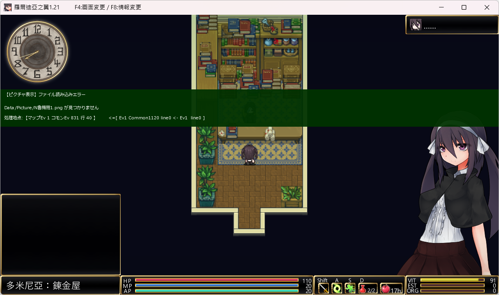

# 羅爾迪亞之翼 v1.21 — 立繪檔名（魯梅爾）修復包

## 問題

進入「多米尼亞：鍊金屋」等會顯示該角色立繪的場景時，畫面中央跳出綠色錯誤訊息並停住：

```
【ピクチャ表示】ファイル読み込みエラー
Data/Picture/N魯梅爾1.png が見つかりません
処理地点:【マップEv 1 コモンEv 831 行 40 】  <=[ Ev1 Common1120 line0 <- Ev1  line0 ]
```



（`buf_scene.png` 為玩家提供的錯誤畫面；畫面右下角仍是正常顯示的其他立繪，
表示立繪系統本身沒壞，只有這一個角色的圖檔名對不上。）

## 成因

中文版把系統資料庫 `SysDatabase.dat`「キャラクター画像」表的**読込ファイル名**欄
翻成了中文 `Picture/N魯梅爾1.png`，但磁碟上的實體圖檔仍是日文檔名
`Data/Picture/Nルメル1.png`。共通事件「■立ち絵表示」照著資料庫的字串開檔，
找不到檔案就報錯。

- 立繪表本體 77 筆中，只有第 23 筆（`0x000092e5`）的**檔名欄**被中文化；
  其餘 76 筆的檔名欄仍是日文、與磁碟一致。
- 該筆的**表示名**欄（`魯梅爾`）本來就該是中文，沒有問題，不動。
- 同一角色的行走圖（`Data/CharaChip/Nルメル.png`）檔名正確，所以人物在地圖上正常，
  只有在顯示立繪時才出錯。
- 不限立繪、擴及全部資源型別的全庫掃描顯示：**整個遊戲的命名錯位只有這一筆**。

## 潛在錯誤統計

- 需修復：**1 個檔案、1 筆記錄、23 bytes 的等長區段**（其中 9 個位元組內容不同）。
- 不處理（已知殘留，與本錯誤無關）：
  - `Picture/FaceGraphic_Edy.png`、`Picture/FaceGraphic_Yuichi.png`：立繪表本體以外的素材區殘留，
    沒有呼叫端使用，也沒有對應圖檔。
  - `Picture2/3-*.png` 舊日文分解圖名：磁碟換成代碼式檔名（`3-ak`／`3-b`…），
    沒有可推得的對照表，未證實會被觸發。
- 不需要讀取或修改玩家存檔。

## 修改方法

採「還原資料庫字串」（分析報告的 C2）：

- 把 `Data/BasicData/SysDatabase.dat` 該筆的「読込ファイル名」
  由 `Picture/N魯梅爾1.png` 改回 `Picture/Nルメル1.png`。
- **不改檔名、不搬圖檔、不動表示名與記錄順序**。
- 新舊字串的 UTF-8 長度同為 23 bytes，屬等長就地替換，
  `.dat` 的字串長度欄位不需重建，**檔案大小不變**（43,027 bytes）。

## 環境

- 遊戲：`072project_Wings of Roldea_TC`（繁中 v1.21）。
- 系統：Windows + Windows PowerShell 5.1（`fix.bat` 會呼叫 `powershell`）。

## 使用

雙擊 `fix.bat`，依選單操作：

```
0 - 取消，不做任何變更
1 - 安裝修復 - 把 SysDatabase.dat 該筆的檔名欄由中文改回日文
2 - 卸載修復 - 還原成安裝修復之前的原樣
```

第一次執行若找不到遊戲路徑，會詢問遊戲本體路徑，並可選擇記到
`fix.config.txt`（下次直接執行即可；換路徑時編輯該檔的 `GAME_DIR = ...`）。


## 還原與備份位置

- 備份：`backup/<時間>/pre-fix/SysDatabase.dat`
- 紀錄：`backup/<時間>/pre-fix/manifest.json`
- 卸載：執行 `fix.bat` 選 `2`，會使用符合 manifest 的最近一份備份還原。

## 驗證

安裝後工具會印出「檔案大小 43,027 → 43,027」與「舊字串殘留 -1 位置、新字串 1 位置」。
之後重新啟動遊戲，回到原本出錯的場景（多米尼亞：鍊金屋）確認不再跳出
`【ピクチャ表示】ファイル読み込みエラー`。

> `Game_ErrorLog.txt` 會被下一次錯誤覆寫，驗證前建議先保留現有日誌副本。


## 注意

- 本工具是為 v1.21 的檔案狀態設計的。若遊戲版本不同、或該字串已被其他工具改過，
  工具會在 dry-run／套用前依狀態檢查停止，不會硬改。
- 只處理「資料庫檔名欄被翻譯、實體圖檔未更名」這一類；其餘已知缺檔引用不在範圍內。
- 本包與「羅爾迪亞之翼-酒場人物無法對話」是兩個獨立問題（那邊是共通事件呼叫名稱被翻譯），
  兩者互不影響、可各自安裝／卸載。

